<p align="center">
  
</p>

<p align="center">
  <strong>An embeddable BPMN and DMN workflow engine for Python applications.</strong><br>
  The workflow core of m8flow: import it, pass it a database session, and run
  processes inside your own application.
</p>

<p align="center">
  <a href="https://github.com/AOT-Technologies/m8flow-core/actions/workflows/ci.yml"></a>
  
  <a href="LICENSE"></a>
</p>

# m8flow-core

m8flow-core is the workflow core of [m8flow](https://github.com/AOT-Technologies/m8flow).
It runs Business Process Model and Notation (BPMN) 2.0 processes and
Decision Model and Notation (DMN) decision tables inside your own Python
process, on top of [SpiffWorkflow](https://github.com/sartography/SpiffWorkflow)
and SQLAlchemy. You import it, pass it a database session, and call commands
and queries. There's no server to deploy.

It's a library, in the same spirit as an embedded Camunda engine: your
application owns the HTTP layer, the users, and the transaction. The library
owns the workflow state.

<p align="center">
  
</p>

## Features

The library covers the following:

- **Process definitions.** Import BPMN XML and optional DMN XML, validated
  before anything is stored.
- **Process execution.** Start instances from stored definitions and run them
  through exclusive and parallel gateways, script tasks, and DMN business rule
  tasks.
- **Human tasks.** Build worklists of work items from BPMN lanes, then claim
  and complete them, safely under concurrency. Form values you submit are
  stored as process metadata.
- **Lifecycle control.** Suspend, resume, error, retry, and terminate process
  instances, with an event history for each one.
- **Timers and scheduled retries.** Timer start events, intermediate timers,
  interrupting boundary timers, and delayed retries, stored as database jobs
  that your application polls.
- **Service tasks.** Run BPMN service tasks through pluggable connectors,
  including an adapter for the m8flow connector proxy.
- **Multi-tenancy and authorization.** Every call is scoped to a tenant, and
  stored data, down to workflow payloads, belongs to one tenant. User actions
  are checked against tenant membership and command grants on exact
  resources, and you can plug in your own policy.
- **Caller-owned transactions.** Pass a SQLAlchemy `Connection` and the
  library never commits or rolls back for you.

## Quick start

You need Python 3.12 and [uv](https://docs.astral.sh/uv/). To install the
project and run a complete purchase-order workflow on an in-memory SQLite
database, run the following commands:

```bash
git clone https://github.com/AOT-Technologies/m8flow-core.git
cd m8flow-core
uv sync
uv run python examples/parallel_review.py
```

The script imports a BPMN definition, starts a process instance, and drives
it through a parallel review to completion, printing the pending tasks after
each step.

The core of an integration looks like the following:

```python
from m8flow_core import api

with engine.begin() as connection:
    definition = api.execute_command(
        connection,
        api.ImportBpmnProcessDefinitionCommand(
            tenant_id="acme",
            bpmn_identifier="expense-approval",
            user_id=admin_id,
            source_bpmn_xml=bpmn_xml,
            properties_json={"lane_owners": {"Approvers": ["approver"]}},
        ),
    )
    instance = api.execute_command(
        connection,
        api.InitializeProcessInstanceFromDefinitionCommand(
            tenant_id="acme",
            bpmn_process_definition_id=definition.id,
            process_initiator_id=admin_id,
        ),
    )
    tasks = api.execute_query(
        connection,
        api.GetPendingTasksQuery(tenant_id="acme", user_id=approver_id),
    )
```

The [quick start tutorial](docs/tutorials/quick-start.md) builds this into a
complete script, from an empty database to a finished process. Running the
finished script looks like this:

<p align="center">
  
</p>

## Documentation

The full documentation is in [`docs/`](docs/README.md). The pages follow the
[Diátaxis](https://diataxis.fr/) structure. Find your task in the following
table:

| I want to… | Read |
|---|---|
| Run my first workflow | [Quick start](docs/tutorials/quick-start.md) |
| Add the library to my application | [Embed the library in your application](docs/how-to/embed-in-your-application.md) · [Build and install the package](docs/how-to/build-and-install-the-package.md) |
| Run timers and scheduled retries | [Run timers and scheduled retries](docs/how-to/run-timers-and-retries.md) |
| Call an external system from a process | [Call external services from service tasks](docs/how-to/call-external-services.md) |
| Add my own authorization rules | [Customize authorization](docs/how-to/customize-authorization.md) |
| Upgrade from `m8flow-bpmn-core` 0.x | [Upgrade to 1.0](docs/how-to/upgrade-to-1.0.md) |
| Look up a command, query, or error | [Public API reference](docs/reference/api.md) · [Database schema](docs/reference/database-schema.md) |
| Check which BPMN elements work | [BPMN support](docs/reference/bpmn-support.md) · [Limitations](docs/reference/limitations.md) |
| Understand how it fits together | [Architecture](docs/explanation/architecture.md) · [Workflow data model](docs/explanation/workflow-data-model.md) |
| Try the runnable examples | [Run the examples](docs/how-to/run-the-examples.md) · [Sample app](sample_app/README.md) |
| Change the library itself | [Develop and test](docs/how-to/develop-and-test.md) |

## Project status

m8flow-core 1.0 is the first stable release. The public surface is the
`m8flow_core.api` module, documented in the
[API reference](docs/reference/api.md), together with the
[database schema](docs/reference/database-schema.md). The
[changelog](CHANGELOG.md) records every change to either. Coming from
`m8flow-bpmn-core` 0.x? Follow [Upgrade to 1.0](docs/how-to/upgrade-to-1.0.md). Messaging and correlation, call
activities, multi-instance activities, and tenant and user management aren't
covered yet. [Limitations](docs/reference/limitations.md) lists every known
gap.

## Get help and contribute

Use the following resources:

- Read [SUPPORT.md](SUPPORT.md) for where to ask questions.
- Report bugs and request features in the
  [issue tracker](https://github.com/AOT-Technologies/m8flow-core/issues).
- Report security vulnerabilities privately, as described in
  [SECURITY.md](SECURITY.md). Don't open a public issue.
- Before you open a pull request, read the [contributing guide](CONTRIBUTING.md).
- Everyone who takes part follows the [code of conduct](CODE_OF_CONDUCT.md).
- Release notes are in the [changelog](CHANGELOG.md).

## License

m8flow-core is released under the [Apache License 2.0](LICENSE). See
[NOTICE](NOTICE) for third-party attributions, including the LGPL-3.0
dependencies SpiffWorkflow and psycopg.
