# About the architecture

m8flow-core is a workflow engine you embed, not a service you call. This
page explains how it's shaped, where it stops and your application starts,
and why it's built that way.

## A library, not a service

The library runs inside your Python process. There's no HTTP API, no
background thread, and no process to deploy. Your application imports
`m8flow_core.api`, passes it a database handle, and calls functions.

This is the same model as an embedded Camunda engine. It lets each host
application keep its own HTTP layer, sign-in, and deployment, while the
workflow behavior stays the same everywhere. The m8flow backend is one such
host; the [sample app](sample-app-integration.md) is another.

The split of responsibilities is the following:

| Your application owns | The library owns |
|---|---|
| HTTP routes, UI, and sign-in | BPMN and DMN parsing and validation |
| Tenants and users | Workflow execution, through SpiffWorkflow |
| The database engine, migrations, and transactions | Process, task, metadata, and event state |
| When the scheduler wakes up | Which jobs are due and what they do |
| Connector deployment, such as the connector proxy | Calling connectors from service tasks |

The following figure follows one call from your application through the
public API and the library's services into your database:

  

## Commands and queries

The API separates writes from reads. A **command** changes state, such as
`ClaimTaskCommand`. A **query** reads it, such as `GetPendingTasksQuery`.
Commands go through `execute_command` and queries through `execute_query`. If
you pass the wrong kind, the dispatcher raises `TypeError` instead of guessing.

Every command and query is a frozen, slotted dataclass, so it can't change
after you create it. `tenant_id` is always the first field, so every call
names its tenant up front and there's no implicit tenant context to get wrong.

The dispatcher routes each dataclass to a service function in
`m8flow_core.services`. You can call those functions directly through
`api` too.

## Caller-owned transactions

The library never decides when your data is committed. If you pass a
`Connection`, it opens a temporary `Session` on it, does its work, and leaves
the transaction open. You commit or roll back.

This means a workflow call can share one transaction with your own writes.
For example, completing a task and updating your own order table either both
happen or neither does.

There's one deliberate exception. When a service task fails while a process
starts, while a timer fires, or during a retry, the library saves the failed
state in a separate, narrow transaction. Without that, a caller that rolls
back on any exception would lose the instance it needs to retry.
[About service task execution](service-task-execution.md#the-failure-transaction-rule)
covers the rule.

## Tenancy

Process definitions, instances, tasks, and scheduler jobs each belong to a
tenant, and every call names one.
Any call that takes a `user_id` checks that the user belongs to the tenant
before it does anything else, and there's no query that reads across tenants.
[About authorization and tenancy](authorization-and-tenancy.md) explains how
membership and permissions are decided.

## Workflow state

SpiffWorkflow does the BPMN execution. After each step, the library serializes
the workflow and stores it with the process instance, alongside its own
tables:

- `work_item` rows for the tasks people work on, holding claim state, so
  worklists are plain queries.
- `process_instance_metadata` rows for form values, so they're readable
  without restoring the workflow.
- `process_instance_event` rows for the history of each instance.
- `scheduler_job` rows for timers and retries, as described in
  [About scheduling](scheduling.md).

The next call restores the workflow from the stored state, so no workflow
lives in memory between calls. Any process can pick up any instance.

The schema is kept compatible with the m8flow backend's database, so a host
application and m8flow can share a database and the m8flow UI can show
instances the library created.

## The public surface

Only `m8flow_core.api` is public. The [API reference](../reference/api.md)
documents it, and `tests/test_api_surface.py` locks the exported names so a
change to them is always deliberate. The ORM models it returns are public
only in the columns the reference names.

## Related pages

- [Repository layout](../reference/repository-layout.md)
- [Embed the library in your application](../how-to/embed-in-your-application.md)
- [Public API reference](../reference/api.md)
