# About scheduling

Timers and scheduled retries in m8flow-core are rows in a database table,
not in-memory timers. This page explains that table, how each kind of job is
created and run, and how the execution modes share it.

The internals described here aren't part of the public API. The only public
entry point is `api.run_due_scheduler_jobs`, documented in the
[API reference](../reference/api.md#scheduler).

## Design goals

The scheduler has three goals:

- **Survive restarts.** Due work is stored in the database, so nothing is lost
  when a process stops.
- **Keep BPMN logic in the library.** Your application only decides when to
  wake up. The library decides what's due and what it means.
- **Support more than one runner.** The same stored jobs work with an inline
  loop in your application or with a Celery worker, as m8flow uses.

## The scheduler job table

Each logical scheduled action is one row in `scheduler_job`, mapped by
`SchedulerJobModel` in `src/m8flow_core/models/scheduler_job.py`. It has
the following columns:

| Column | Type | Null | Notes |
|---|---|---|---|
| `id` | integer | No | Primary key |
| `m8f_tenant_id` | string | No | Foreign key to `m8flow_tenant.id`. Every scheduler read and write is tenant-scoped. |
| `job_key` | string(255) | No | Deduplication key for the logical job, unique within the tenant |
| `job_type` | string(50) | No | Indexed. One of `intermediate_timer`, `process_retry`, or `timer_start`. |
| `process_instance_id` | integer | Yes | Foreign key to `process_instance.id`, for jobs that belong to a running instance |
| `bpmn_process_definition_id` | integer | Yes | Foreign key to `bpmn_process_definition.id`, for jobs that belong to a definition, such as timer starts |
| `locked_by` | string(255) | Yes | The worker that claimed the job. `NULL` means unclaimed. |
| `locked_at` | timezone-aware datetime | Yes | When the job was claimed |
| `run_at` | timezone-aware datetime | No | Indexed. When the job is due. |
| `payload_json` | JSON | No | Job-specific data, such as a timer descriptor or retry context. Defaults to `{}`. |
| `updated_at` | timezone-aware datetime | No | Last change |
| `created_at` | timezone-aware datetime | No | First insert |

The `process_instance` and `bpmn_process_definition` relationships cascade, so
deleting an instance or a definition deletes its jobs.

The unique constraint `uq_scheduler_job_tenant_job_key` allows one `job_key`
per tenant. That's what lets a job be rescheduled by updating its row instead
of adding a new one. `job_type` is validated against `SchedulerJobType` when
the row is written, and an invalid value raises `ValidationError`.

SpiffWorkflow serializes a timer's due time as epoch seconds inside its own
workflow data. Those values stay in the payload: the runtime converts them to
a timezone-aware `datetime` before it writes `run_at`, and no scheduler column
stores epoch seconds.

In practice, the table behaves like a small durable queue:

1. The workflow runtime inserts or refreshes a row when it finds future work.
2. A scheduler pass lists the rows that are due.
3. It claims each row by setting `locked_by`.
4. When the job runs, the row is either deleted or rewritten with its next due
   time.

## Storage helpers

The helpers in `src/m8flow_core/services/scheduler_jobs.py` are internal
building blocks.

### Job keys

`build_scheduler_job_key` builds a deterministic, pipe-delimited key from the
job type, an optional process instance ID, an optional definition ID, and an
optional qualifier, such as a BPMN element ID:

```text
intermediate_timer|pi:12|q:TimerCatch_1
timer_start|pd:34|q:StartEvent_1
```

It rejects a blank qualifier, and it rejects a key with no instance,
definition, or qualifier at all. A deterministic key prevents collisions
between unrelated jobs, and it lets a later workflow save recompute the same
key and update the same row.

### Upsert

`upsert_scheduler_job` writes or reschedules a job. It looks the row up by
tenant and `job_key`, inserts it if it's missing, and otherwise updates
`job_type`, both scope IDs, `run_at`, `payload_json`, and
`updated_at`. It keeps `created_at` unless told
otherwise.

When it updates a row, it also clears `locked_by` and `locked_at`.
A rescheduled job is therefore visible to the next pass, instead of staying
stuck in a claim from an earlier attempt.

### Delete

`delete_scheduler_job` removes a row by tenant and `job_key`. Because the
tenant is part of the lookup, a caller can't delete another tenant's job even
if it knows the key. The runtime calls it when a timer stops waiting or a
retry is consumed.

### Listing due jobs

`list_due_scheduler_jobs` returns rows where `run_at` is at or
before now and `locked_by` is `NULL`, optionally for one tenant. It orders
them by `run_at`, then `id`, so passes are deterministic when
several jobs share a due second. It requires a positive limit.

It only lists candidates. Claiming and running happen in the runtime layer,
so the same helper can serve an inline loop and a future dispatcher.

## Job lifecycles

Every job follows the same path: something creates it, the table stores it,
and `run_due_scheduler_jobs` lists, claims, and runs it, then reschedules or
deletes it.

<p align="center">
  
</p>

### Timer start lifecycle

Importing a definition with a timer start event creates a definition-scoped
`timer_start` job. When it's due, the runner creates a new process instance,
started by an internal tenant-scoped system user. For a finite `timeCycle`,
such as `R3/PT20S`, the runner rewrites the row with the next due time after
each firing, and deletes it after the last one.

### Intermediate and boundary timer lifecycle

Intermediate timer catch events and interrupting timer boundary events share
the `intermediate_timer` job type. Whenever the runtime saves a workflow, it
scans for waiting timers and writes one instance-scoped job for them.

When the job is due, the runner does the following:

1. Reloads the process instance by tenant and ID.
2. Restores the stored workflow and refreshes its waiting tasks.
3. Runs the workflow, so the timer fires inside SpiffWorkflow.
4. Saves the new workflow state and its task rows.
5. Closes any open work item whose workflow task is no longer active. For an
   interrupting boundary timer, that cancels the attached task.
6. Creates work items for anything newly ready, such as the timeout path.
7. Refreshes the job if more timers are waiting, or deletes it.

A boundary timer doesn't create a new instance. It changes the current one:
the attached task leaves the worklist as `CANCELLED`, and the timeout task
becomes `READY` on the same instance.

### Scheduled retry lifecycle

A scheduled retry is a scheduler job on top of the normal lifecycle, not a
separate retry engine. `ScheduleProcessInstanceRetryCommand` writes one
`process_retry` job per instance, with
`payload_json = {"requested_by_user_id": ..., "scheduled_at": ...}`,
where `scheduled_at` is an ISO 8601 string.

When the job is due, the runner does the following:

1. Reloads the process instance by tenant and ID.
2. If the instance is no longer in `error`, deletes the job and stops.
3. Otherwise, calls the normal retry service as the user who scheduled it.
   The instance goes from `error` to `running`, `ended_at` is cleared,
   terminated runtime tasks reopen, and terminated work items go back to
   `READY`.
4. Records `process_instance_retried` and deletes the job.

If the error came from a service task, the retry also restores the stored
workflow, resets the failed branch, and runs it again straight away.

A retry doesn't create a new process instance. The retry example checks this:
after the job fires, the instance ID is unchanged and the original work item
ID is back in the worklist.

## Execution modes

The stored jobs are the same whichever way they're run.

### Inline loop

Your application runs a loop, or a small worker process, that calls
`api.run_due_scheduler_jobs` on a schedule. The application decides when to
wake up. The library claims due jobs, starts timer instances, restores and
advances workflows, runs retries, and reschedules timers.

If one claimed job fails, the runner releases its lock, finishes the other
jobs in the batch, and then raises: the original error for one failure, or a
summary `BpmnCoreError` for several.

The inline mode assumes one poller per database or tenant. The claim columns
are stored in every mode, so multi-worker coordination can be added later
without a schema change.

### Celery

A Celery deployment drives the same jobs through Celery workers instead of an
inline loop. That fits m8flow's architecture: state in the database, Celery
for worker transport and isolation, and the host application restoring tenant
and session context.

`examples/celery_scheduler.py` shows the minimal setup. It adds no new
library API: Celery beat calls `api.run_due_scheduler_jobs` on a schedule,
over the same Redis broker m8flow uses. A library-owned Celery dispatcher
doesn't exist yet.

## Related pages

- [Run timers and scheduled retries](../how-to/run-timers-and-retries.md)
- [BPMN support](../reference/bpmn-support.md)
- [Limitations](../reference/limitations.md#timers-and-scheduling)
