# About service task execution

m8flow-core runs BPMN service tasks synchronously, through connectors
that your application registers. This page explains how a service task call
works, how it maps onto the m8flow connector proxy, and why some failures are
saved outside your transaction.

## Connectors and the registry

The library doesn't know how to send an email or call an API. A **connector**
does: an object with a `connector_key` that runs commands. A **registry** maps
connector keys to connectors, and your application installs it for a block of
calls or for the whole process.

This keeps the library a library. The connector proxy is the only deployed
connector runtime m8flow uses today, so the library ships an adapter for it.
Other runtimes, such as NodeWire, can be added later behind the same protocol.

## Operation IDs

SpiffWorkflow identifies a service task's operation with a string. For m8flow
compatibility, the library reads it as:

```text
<connector_key>/<command_name>
```

For example, `http/GetRequestV2`, `smtp/SendHTMLEmail`, or
`postgres_v2/DoSQL`. `build_service_task_operation_id` and
`split_service_task_operation_id` build and validate these IDs.

## What happens when a workflow reaches a service task

Service tasks run wherever the workflow advances: when a process starts,
when a timer starts or wakes one, and after a user task is completed. At each
service task, the library does the following:

1. Reads the operation ID, such as `http/GetRequestV2`.
2. Evaluates the BPMN parameter expressions with the normal script engine.
3. Finds the connector for the connector key in the active registry.
4. Calls the connector and waits for it.
5. Stores the result payload in the BPMN result variable.

Any exception from the connector reaches the caller as
`ServiceTaskExecutionError`.

## The connector proxy contract

The `m8flow-connector-proxy` adapter relies on three conventions of the proxy:

- `GET /v1/commands` returns the command catalog, with each command's
  parameters.
- `POST /v1/do/<connector_key>/<command_name>` runs a command, for example
  `POST /v1/do/http/GetRequestV2`.
- Request keys that start with `spiff__` are reserved. The proxy removes them
  before it builds the command. `spiff__task_data` carries the workflow data,
  and `spiff__callback_url` is the callback target for asynchronous
  connectors.

The library only supports synchronous calls, but `spiff__callback_url` is part
of the contract because the proxy already has it. The adapter turns the
proxy's JSON error responses into `ServiceTaskExecutionError`.

## The failure transaction rule

The design has to keep two promises at once:

1. The caller sees a connector failure straight away, as
   `ServiceTaskExecutionError`.
2. The same process instance can be retried afterwards.

These conflict, because many host applications wrap each call in a helper,
such as `db.session_scope(...)`, that rolls back when an exception escapes. A
plain rollback would erase the failed state that a retry needs.

The following figure shows how the library keeps both promises. The failure
reaches you, and the failed state survives your rollback so you can retry:

<p align="center">
  
</p>

So the library saves a narrow recovery state in its own transaction, separate
from the caller's, on these paths:

- starting a process instance
- starting a process instance from a timer
- waking a waiting workflow when its timer fires
- rerunning a failed service task during a retry

On those paths, when a service task fails, the runtime does the following:

1. Keeps the workflow snapshot with the failed task in `ERROR`.
2. Saves that snapshot into the stored runtime state.
3. Records a `task_failed` event for the service task.
4. Moves the process instance to `error` and records `process_instance_error`.
5. Raises `ServiceTaskExecutionError` to the caller.

That separate transaction commits only what recovery needs: the process
instance row, the failed workflow snapshot, the task and work item states,
the two events, and the `error` status. None of the caller's own writes go
with it.

To start a process safely, this means a two-phase flow:

1. Save a minimal process instance and runtime shell.
2. Run the risky service task path.
3. If the connector fails, save the retryable error state durably, then raise.

On retry, the library restores the saved workflow, resets the failed branch,
and runs it again. If the call succeeds, the process moves on. If it fails
again, the instance goes back to `error` with a new `task_failed` and
`process_instance_error` pair. You can retry with
`RetryProcessInstanceCommand` or schedule one with
`ScheduleProcessInstanceRetryCommand`.

### The exception: after a task is completed

Service tasks that run after `CompleteTaskCommand` don't get the separate
transaction yet. Their failure state is part of the caller's transaction. If
the caller rolls back, the task completion and the failure state roll back
together, and the task stays uncompleted.

### Database support

PostgreSQL is the reference database for this behavior. SQLite's locking
can't reliably run an independent writer while the outer, failing transaction
is open, so the tests for this behavior are marked as expected failures on
SQLite.

## Related pages

- [Call external services from service tasks](../how-to/call-external-services.md)
- [Service task hooks in the API reference](../reference/api.md#service-task-hooks)
- [Limitations](../reference/limitations.md#service-tasks)
