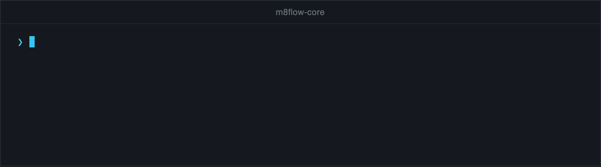

<!--
SPDX-FileCopyrightText: 2026 AOT Technologies

SPDX-License-Identifier: Apache-2.0
-->

# Develop and test

This guide covers the day-to-day commands for working on m8flow-core:
setting up the environment and hooks, the lint, type, and security checks, the
unit, PostgreSQL, and sample app tests, and migrations. The [contributing guide](../../CONTRIBUTING.md) has
the rules a pull request must follow.

<p align="center">
  
</p>

## Set up the environment

Use Python 3.12 and [uv](https://docs.astral.sh/uv/). To install the project
and its development tools, run the following command from the repository
root:

```bash
uv sync
```

To also install the PostgreSQL driver, run `make sync-postgresql` or
`uv sync --extra postgresql`. Run every tool through `uv run`, so it uses the
project environment.

Run `make help` to list every `make` target.

## Install the Git hooks

The repository's pre-commit hooks run Ruff, mypy, Bandit, and REUSE before each
commit. A `commit-msg` hook rejects any commit without a `Signed-off-by`
trailer, so commit with `git commit -s`. To install the hooks, run the
following command:

```bash
make precommit-install
```

## Run the static checks

CI runs five static checks. To run them yourself, use the following
commands:

```bash
make lint
make format-check
make typecheck
make security
make license-headers
```

`make lint` runs [Ruff](https://docs.astral.sh/ruff/) for linting and import
ordering; `make lint-fix` applies the fixes Ruff can make on its own.
`make format-check` runs the Ruff formatter in check mode on the whole
repository, including Python code blocks in Markdown; `make format`
reformats the files.
`make typecheck` runs mypy on `src/m8flow_core/`. `make security` runs
[Bandit](https://bandit.readthedocs.io/) on the library and the sample app.
`make license-headers` runs [REUSE](https://reuse.software/) to check that
every file declares its copyright and license, and `make license-headers-fix`
adds the SPDX header to new files that lack one. See
[Add license headers](../../CONTRIBUTING.md#add-license-headers).

## Run the unit tests

The unit tests call the library directly. They need no server and use a
temporary SQLite database by default. To run them, use the following
command:

```bash
make test
```

CI measures line coverage of `m8flow_core` and fails below 80%, the
`fail_under` value in `pyproject.toml`. On a pull request, CI also fails when
less than 80% of the lines the pull request changes in `src/m8flow_core` are
covered. To run both checks against `main`, use the following commands:

```bash
uv run pytest --cov=m8flow_core --cov-report=xml:coverage.xml
uv run diff-cover coverage.xml --compare-branch=origin/main --fail-under=80
```

After a merge to `main`, CI uploads the coverage report to
[Codecov](https://codecov.io/gh/AOT-Technologies/m8flow-core), which feeds
the coverage badge in the README. A failed upload doesn't fail the build.

Every pull request and every push to `main` runs the suite on Python 3.12,
3.13, and 3.14 on Linux, macOS, and Windows.

To run one file or one test, pass it to pytest:

```bash
uv run pytest tests/test_application_layer.py
uv run pytest tests/test_application_layer.py -k retry
```

Some tests cover workflow scenarios end to end:

| Test file | Scenario |
|---|---|
| `tests/test_workflow_poc.py` | Invoice approval through claim, suspend, resume, error, retry, complete, and terminate, with both gateway branches |
| `tests/test_conditional_approval_poc.py` | Conditional approval with lanes, a DMN decision, and Finance escalation |
| `tests/test_parallel_review_poc.py` | Parallel review, including a check that one branch alone doesn't release the join |

## Run the unit tests against PostgreSQL

To run the same suite against PostgreSQL, install the driver and point
`M8FLOW_TEST_DATABASE_URL` at a dedicated, empty test database:

```bash
uv sync --extra postgresql
M8FLOW_TEST_DATABASE_URL=postgresql+psycopg://<user>:<password>@localhost:5432/m8flow_core_test \
    uv run pytest
```

Replace `<user>` and `<password>` with the credentials of your test database.

PostgreSQL is the reference database. A few tests of rollback-safe service
task failures are marked as expected failures on SQLite, because SQLite can't
run an independent writer while the outer transaction is open.

## Run the PostgreSQL integration test

The integration tests start a temporary `postgres:16` container and run the
public API against it. They exercise transaction control, the conditional
approval BPMN and DMN fixtures, and compensation rollback and restart. With
Docker running, use the following command:

```bash
make test-integration
```

To use a different image, set `M8FLOW_TEST_POSTGRES_IMAGE`.

Without Docker, point `M8FLOW_TEST_POSTGRES_URL` at a dedicated, empty
PostgreSQL database instead. The test then skips the container, creates the
schema in that database, and drops it again at the end:

```bash
M8FLOW_TEST_POSTGRES_URL=postgresql+psycopg://<user>:<password>@localhost:5432/m8flow_core_test \
    make test-integration
```

The baseline migration tests also run against PostgreSQL when
`M8FLOW_POSTGRES_UPGRADE_DATABASE_URL` points at a dedicated, empty database.
They apply Alembic head, verify upgrades from the baseline and the signal
revision, and compare the result with the models. They also check timestamps
after 2038, cross-tenant compensation foreign keys, and downgrade behavior.
The PostgreSQL CI job supplies the migration database and runs every
integration test in `integration/`. Without the variable, the migration cases run on SQLite.

## Run the sample app tests

CI also builds the wheel, stages it into the sample app, and runs the sample
app's own checks. To do the same, run the following commands from the
repository root:

```bash
uv build --wheel
bash sample_app/scripts/stage_local_wheel.sh
cd sample_app
uv sync --locked
uv run --locked ruff check src tests
uv run --locked ruff format --check src tests
uv run --locked pytest
```

## Smoke test the built wheel

CI installs the built wheel into a clean environment, outside the source tree,
and runs `tools/smoke_test.py`; the publish workflow does the same for both the
wheel and the sdist. The script imports the
installed package and runs the parallel-review workflow to completion. To do
the same, run the following commands from the repository root:

```bash
uv build --wheel --out-dir /tmp/m8flow-smoke/dist
uv venv --python 3.12 /tmp/m8flow-smoke/venv
uv pip install --python /tmp/m8flow-smoke/venv/bin/python /tmp/m8flow-smoke/dist/*.whl
(cd /tmp/m8flow-smoke && venv/bin/python -I "$OLDPWD/tools/smoke_test.py" \
    "$OLDPWD/tests/fixtures/parallel_review_poc.bpmn" --expect-installed)
```

The script prints `PASS` and exits with status 0 when the workflow completes.

## Apply migrations

The Alembic history in `alembic/versions/` starts at the 1.0 baseline,
`k2l3m4n5o6p7`, and creates the library's tables in the database set by
`M8FLOW_DATABASE_URL`, which defaults to a SQLite file named `m8flow.db`. To
apply it, and to confirm the database matches the models, run the following
commands:

```bash
uv run alembic upgrade head
uv run alembic check
```

If you change a model in `src/m8flow_core/models/`, add a migration on top of
the current head in the same pull request. Never edit a released migration,
including the baseline: released revisions are immutable.

## Build the package

If you change dependencies or the public exports, check that the package still
builds with `make package`.
[Build and install the package](build-and-install-the-package.md) covers the
details.

## Related pages

- [Contributing guide](../../CONTRIBUTING.md)
- [Repository layout](../reference/repository-layout.md)
- [Configuration](../reference/configuration.md)
- [Run the examples](run-the-examples.md)
