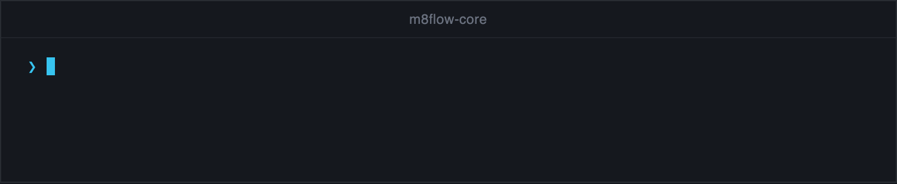

# Quick start: run your first workflow

In this tutorial, you build a Python script that runs a one-step expense
approval workflow with m8flow-core. The script creates a database,
imports a BPMN process, starts it, and has an approver claim and complete
the task. It takes about 10 minutes and needs no database server: everything
runs on an in-memory SQLite database.

## Before you begin

You need the following:

- Python 3.12
- [uv](https://docs.astral.sh/uv/)
- A clone of this repository with its dependencies installed:

  ```bash
  git clone https://github.com/AOT-Technologies/m8flow-core.git
  cd m8flow-core
  uv sync
  ```

## Write the BPMN process

The workflow has one user task, **Approve expense**, inside a lane named
`Approvers`. The lane decides who gets the task.

Create a file named `first_workflow.py` in the repository root, and add the
imports and the BPMN XML:

```python
from sqlalchemy.orm import Session

from m8flow_core import api
from m8flow_core.db import build_engine, create_schema
from m8flow_core.models.tenant import M8flowTenantModel
from m8flow_core.models.user import UserModel
from m8flow_core.services.authorization import (
    ROLE_ADMIN,
    ROLE_USER,
    ensure_v1_role,
)

TENANT_ID = "acme"

BPMN_XML = """<?xml version="1.0" encoding="UTF-8"?>
<bpmn:definitions xmlns:bpmn="http://www.omg.org/spec/BPMN/20100524/MODEL"
                  id="Definitions_expense" targetNamespace="http://bpmn.io/schema/bpmn">
  <bpmn:process id="Process_expense" name="Expense approval" isExecutable="true">
    <bpmn:laneSet id="LaneSet_1">
      <bpmn:lane id="Lane_approvers" name="Approvers">
        <bpmn:flowNodeRef>StartEvent_1</bpmn:flowNodeRef>
        <bpmn:flowNodeRef>Task_approve</bpmn:flowNodeRef>
        <bpmn:flowNodeRef>EndEvent_1</bpmn:flowNodeRef>
      </bpmn:lane>
    </bpmn:laneSet>
    <bpmn:startEvent id="StartEvent_1">
      <bpmn:outgoing>Flow_1</bpmn:outgoing>
    </bpmn:startEvent>
    <bpmn:sequenceFlow id="Flow_1" sourceRef="StartEvent_1" targetRef="Task_approve" />
    <bpmn:userTask id="Task_approve" name="Approve expense">
      <bpmn:incoming>Flow_1</bpmn:incoming>
      <bpmn:outgoing>Flow_2</bpmn:outgoing>
    </bpmn:userTask>
    <bpmn:sequenceFlow id="Flow_2" sourceRef="Task_approve" targetRef="EndEvent_1" />
    <bpmn:endEvent id="EndEvent_1">
      <bpmn:incoming>Flow_2</bpmn:incoming>
    </bpmn:endEvent>
  </bpmn:process>
</bpmn:definitions>
"""
```

## Create a tenant and two users

Every call to the library is scoped to a tenant, and every user action is
checked against the user's tenant and role. The library doesn't manage
tenants or users itself, so your application creates them. In this script, an
`admin` user imports and starts the process, and an `approver` user completes
the task.

Add a `seed` function to the file:

```python
def seed(session: Session) -> tuple[UserModel, UserModel]:
    session.add(M8flowTenantModel(id=TENANT_ID, name="Acme", slug="acme"))
    admin = UserModel(
        username="admin",
        email="admin@example.com",
        service="http://localhost/realms/acme",
        service_id="admin",
    )
    approver = UserModel(
        username="approver",
        email="approver@example.com",
        service="http://localhost/realms/acme",
        service_id="approver",
    )
    session.add_all([admin, approver])
    session.flush()
    ensure_v1_role(session, tenant_id=TENANT_ID, role_name=ROLE_ADMIN, user_ids=[admin.id])
    ensure_v1_role(session, tenant_id=TENANT_ID, role_name=ROLE_USER, user_ids=[approver.id])
    return admin, approver
```

The `service` URL ends in the tenant slug, `acme`. That's how the library
knows both users belong to the `acme` tenant. `ensure_v1_role` gives the admin
the `admin` role, which can import definitions, and gives the approver the
`user` role, which can claim and complete tasks.

## Import the process and start it

Add a `main` function that creates the database, imports the BPMN, and starts
a process instance:

```python
def main() -> None:
    engine = build_engine("sqlite+pysqlite:///:memory:")
    create_schema(engine)

    with Session(engine, expire_on_commit=False) as session:
        admin, approver = seed(session)

        definition = api.execute_command(
            session,
            api.ImportBpmnProcessDefinitionCommand(
                tenant_id=TENANT_ID,
                bpmn_identifier="expense-approval",
                user_id=admin.id,
                source_bpmn_xml=BPMN_XML,
                properties_json={"lane_owners": {"Approvers": ["approver"]}},
            ),
        )
        instance = api.execute_command(
            session,
            api.InitializeProcessInstanceFromDefinitionCommand(
                tenant_id=TENANT_ID,
                bpmn_process_definition_id=definition.id,
                process_initiator_id=admin.id,
            ),
        )
        print("Started:", instance.id, instance.status)
```

The `lane_owners` property maps the `Approvers` lane to the `approver` user,
so the task in that lane is assigned to them. Starting the instance runs the
workflow until it reaches the user task and stops there.

## Claim and complete the task

Writes go through `execute_command`, and reads go through `execute_query`.
Continue `main` inside the `with` block. The approver lists their pending work
items, claims the first one, and completes it with a form value:

```python
        tasks = api.execute_query(
            session,
            api.GetPendingTasksQuery(tenant_id=TENANT_ID, user_id=approver.id),
        )
        task = tasks[0]
        print("Pending task:", task.task_title)

        api.execute_command(
            session,
            api.ClaimTaskCommand(
                tenant_id=TENANT_ID, work_item_id=task.id, user_id=approver.id
            ),
        )
        api.execute_command(
            session,
            api.CompleteTaskCommand(
                tenant_id=TENANT_ID,
                work_item_id=task.id,
                user_id=approver.id,
                task_payload={"decision": "approved"},
            ),
        )

        instance = api.execute_query(
            session,
            api.GetProcessInstanceQuery(
                tenant_id=TENANT_ID, process_instance_id=instance.id
            ),
        )
        print("Finished:", instance.status)
        session.commit()


if __name__ == "__main__":
    main()
```

The `task_payload` values are stored as process metadata on the instance.

## Run the script

To run the script, use the following command:

```bash
uv run python first_workflow.py
```

The output is the following:

```text
Started: 1 user_input_required
Pending task: Approve expense
Finished: complete
```

The process instance stopped at `user_input_required` while it waited for the
approver, then reached `complete` after the task was done.

<p align="center">
  
</p>

## What you built

You ran the full lifecycle of a human-task workflow through the public API:
import a definition, start an instance, read a worklist, claim, complete, and
read the result. Each call was tenant-scoped and checked against the caller's
role.

## Next steps

- Run a larger workflow with parallel reviewers: `uv run python
  examples/parallel_review_poc.py`. [Run the examples](../how-to/run-the-examples.md)
  lists the others.
- Use the library inside a real application, with your own transaction:
  [Embed the library in your application](../how-to/embed-in-your-application.md).
- See every command, query, and error: [Public API reference](../reference/api.md).
- Learn how the pieces fit together: [About the architecture](../explanation/architecture.md).
